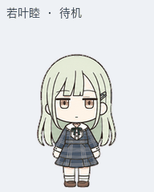
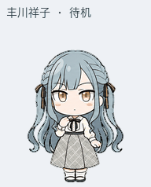
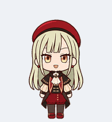

# BanG Dream! Desktop Pets

An unofficial chibi desktop pet collection featuring **Wakaba Mutsumi**, **Togawa Sakiko**, and **Mortis**. Includes the finished transparent sprite sheets, animation previews, original jump variants, and selected generation sources. All three default variants greet when hovered.

The artwork was created with AI image generation, iterative direction, and animation assembly. This is a free, noncommercial fan project, unaffiliated with and not endorsed by BanG Dream!, Bushiroad, or their partners. See [artwork provenance and rights](ARTWORK.md).

| Wakaba Mutsumi | Togawa Sakiko | Mortis |
| --- | --- | --- |
|  |  |  |
| [Sprite sheet](pets/mutsumi/spritesheet.png) · [All animations](pets/mutsumi/previews/all-states.gif) | [Sprite sheet](pets/sakiko/spritesheet.png) · [All animations](pets/sakiko/previews/all-states.gif) | [Sprite sheet](pets/mortis/spritesheet.png) · [All animations](pets/mortis/previews/all-states.gif) |

## Preview and use

Download or clone this repository, then open **[index.html](index.html)** directly. The offline player supports character selection, nine animation states, sixteen look directions, frame stepping, playback speed, light and dark backgrounds, and switching between greeting and jump variants. No build step or network connection is required.

For a Pets import workflow supporting this v2 format, choose the character's `spritesheet.png`. The assets are independent of the original account and pet IDs. Uploading, selecting a pet, and triggering its states are handled by the Pets client.

## Repository layout

```text
pets/
  mutsumi/                      Wakaba Mutsumi
  sakiko/                       Togawa Sakiko
  mortis/                       Mortis
    spritesheet.png             Default variant: greet on hover
    spritesheet-with-jump.png   Backup with the original jump
    manifest.json               Dimensions, frame counts, hashes and mappings
    quality.json                Original QA and packaging consistency records
    previews/                   GIFs, MP4, direction sheets and individual states
    sources/
      strips/                   Selected generated artwork
      prompt-records/           Original prompts and revision records
scripts/validate_assets.py      Local asset validation
catalog.json                    Character catalog
index.html                      Offline animation player
```

## Animation format

Each sprite sheet is a transparent RGBA PNG, `1536 × 2288` pixels, arranged in 8 columns and 11 rows of `192 × 208` cells, with 73 populated frames.

| Row (zero-based) | State | Populated frames |
| --- | --- | ---: |
| 0 | Idle and blinking | 6 |
| 1 / 2 | Move right / move left | 8 each |
| 3 | Greeting | 4 |
| 4 | Default: hover greeting; backup: original jump | 5 |
| 5 | Setback and recovery | 8 |
| 6 | Waiting for input | 6 |
| 7 | Working and thinking | 6 |
| 8 | Review and confirmation | 6 |
| 9 / 10 | Sixteen clockwise look directions | 8 each |

Look directions run clockwise in `22.5°` increments: `0° = up`, `90° = screen right`, `180° = down`, and `270° = screen left`. Idle provides the neutral pose.

In the default variant, row 4 uses the four greeting frames from row 3 followed by the first idle frame. This adapts to the client behavior observed during production, which maps hovering to the `jumping` state. Other triggers for that same state will therefore also play the greeting. The backup variant retains the original jump; every other row is pixel-identical between variants. Preview timings are intended for inspecting the artwork; the client may use a different cadence or scheduling behavior.

## Validation

```bash
python -m pip install -r requirements.txt
python scripts/validate_assets.py
```

The validator checks all six sprite sheets for dimensions, transparent unused cells, populated frames, file hashes, and the exact relationship between the greeting and jump variants. Original production QA also inspected proportions at native size, arm connections, transparent edges, and look directions. Records of pixel comparisons against the uploaded assets are retained in each character's `quality.json`.

Selected generation sources are included in `sources/`. Original prompt records retain the language used during production. Earlier candidates and complete production archives remain in the original project and are not duplicated here.

## License and character rights

The original offline player (`index.html`, including its HTML, CSS, and JavaScript) and asset validator (`scripts/validate_assets.py`) are available under the [MIT License](LICENSE). The license applies only to those code files.

Character artwork, sprite sheets, previews, generation sources, prompt records, and other repository material are outside that code license. BanG Dream! character names, designs, and related intellectual property belong to Bushiroad and/or their respective rights holders. This repository does not grant rights to that underlying intellectual property or imply official authorization.

Read [ARTWORK.md](ARTWORK.md) for provenance and the scope of this notice, and consult the [official BanG Dream! content-use guidelines](https://bang-dream.com/bdp-guideline/) before reusing character assets. Any reuse remains subject to applicable rights and guidelines.
